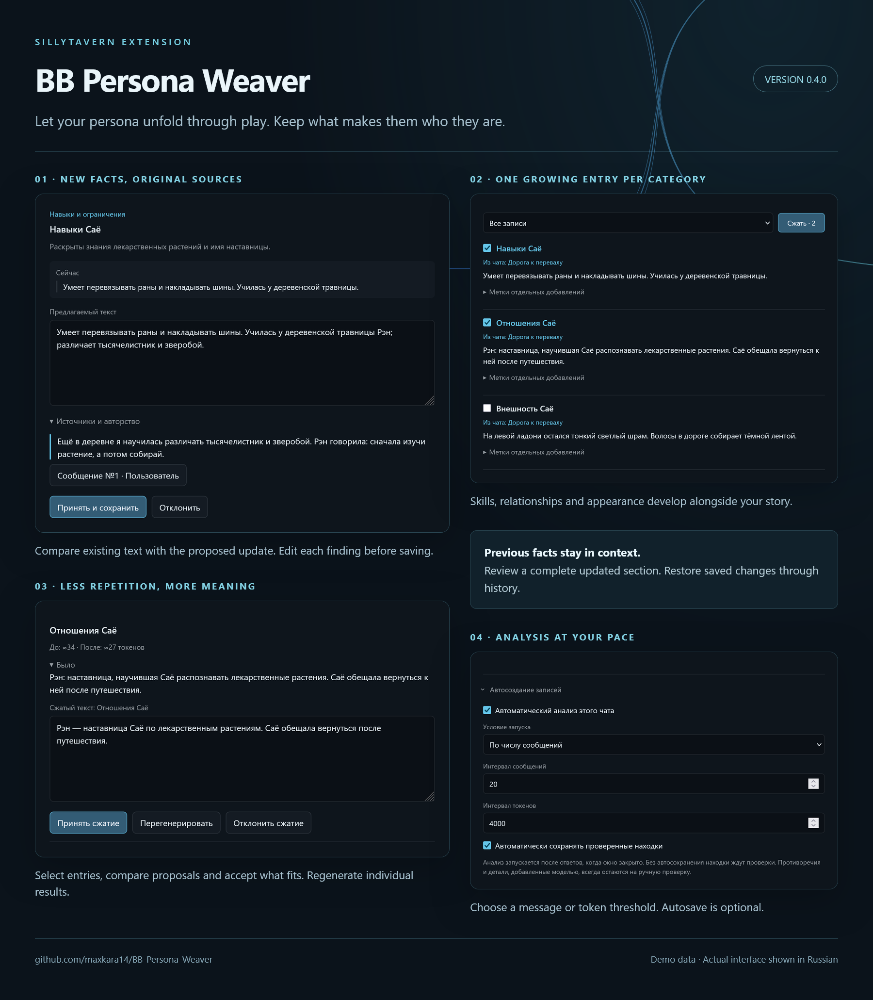

<div align="center">

# 🪶 BB Persona Weaver

**Let your persona unfold through play. Keep the details worth remembering.**

SillyTavern · v0.4.0

[Русский](README.md) · **English** · [Quick start](#-quick-start) · [Automation](#-automatic-entries) · [Changelog](CHANGELOG.md#english)

</div>

---

A **SillyTavern** extension that extracts new facts about your user persona from roleplay and proposes entries for the persona's lorebook: habits, skills, appearance, history, values and relationships.

Start with a short persona description, play, and build the rest along the way. **Weaver shows source quotations and updates existing sections**, helping the book grow with your story.

> Open **the magic wand → Persona Weaver**.
> The installed extension is listed as **BB Persona Weaver**. Settings live inside its window under **⚙**.



## ✨ Features

| | What Weaver does |
|---|---|
| 🔎 **Scene analysis** | Extracts durable new details from an explicit message range |
| 🧵 **Evolving sections** | One growing entry per category; new categories require manual review |
| 💬 **Evidence** | The model references paragraphs; Weaver supplies original text and authorship |
| ✍️ **Review** | Lets you edit text, activation keys and entry settings before saving |
| 🌐 **RU / EN regex** | Requests Russian and English activation keys with Unicode boundaries |
| 📖 **One lorebook** | Uses an existing persona book or creates and binds a new one |
| 🏷️ **Labels** | Tracks general facts and contributions from individual chats |
| ⚙️ **Three connections** | Current ST connection, Connection Manager profile or a separate API |
| ⏱️ **Automation** | Analyzes after a message/token threshold; saving automatically is optional |
| ↩️ **Recovery** | Keeps before/after versions, supports rollback and resumes uncertain saves |
| 🎛️ **Selection and priority** | Personal events are opt-in; new-section priority can be manual, automatic or reverse |

A compact dark interface with a theme-derived accent, stable window geometry and small-screen support. The current interface is in Russian.

## 📦 Installation

1. Open **Extensions → Install extension** in SillyTavern.
2. Paste the repository URL:

   ```text
   https://github.com/maxkara14/BB-Persona-Weaver
   ```

3. Confirm installation and reload the page.
4. Open **the magic wand → Persona Weaver**.

Already installed? Update the existing copy rather than installing a second one.

## 🚀 Quick start

1. Open a saved chat and select your user persona.
2. Open **the magic wand → Persona Weaver**.
3. Choose a connection and model under **⚙**, then click **«Готово»** (Done).
4. Set the inclusive message range and click **«Анализировать»** (Analyze). Message numbers start at zero.
5. Review a suggestion, its sources and proposed text. Adjust its keys and settings as needed.
6. Click **«Принять и сохранить»** (Accept and save). If the persona has no book, one is created on the first save.

Unless automatic saving is enabled, analysis alone does not change the lorebook. An empty result marks a scene as analyzed only with an explicit `no_changes` status and explanation. A bare empty list or refusal does not mark coverage.

### Prepare a book in advance

Open **⚙ → «Лорбук персоны» → «Создать лорбук»**, enter a name and click **«Создать и привязать»** (Create and bind).

Existing names are rejected instead of overwritten. A context change before binding prevents attaching the book to another persona. The previously bound book is not deleted.

## 🧠 What becomes canon

Initial categories cover **appearance**, **habits and preferences**, **skills and limitations**, **history and family**, **values and boundaries**, and **relationships**. Empty sections are not created upfront.

Each category has one persona lorebook entry, with a fixed Russian section title followed by the persona name: «Внешность», «Привычки», «Навыки», «Биография», «Ценности», «Отношения». People get named paragraphs within Relationships, and techniques go inside Skills. The model receives the complete existing section and proposes a full update for review. Existing activation keys and entry settings are retained.

The model may propose a custom category with concrete content and a reason why existing sections do not fit. New categories always require manual acceptance, including during autosave. Rename it or choose another section, then use «Обновить предложение». Routing builds an editable draft from the target's existing text plus the new information; review coherence before saving. Accepted categories can grow in later scenes. Before creating one, check whether an existing section already fits. Only this persona's Weaver-managed sections are treated as categories; unrelated entries are not automatically adopted.

The prompt asks the model to distinguish established facts from isolated actions, temporary emotions, opinions and guesses. This is a model instruction, not a guarantee: review the evidence and proposed text.

**Entry settings → «Сохранять значимые события персоны»** optionally permits concise personal milestones. It is off by default: record persona facts and changes rather than battles, journeys and incidental encounters. Revealed past, new abilities, commitments and lasting changes remain eligible. Accepted history is retained. The policy applies to custom prompts and both manual and automatic analysis. Updates include the full previous section and request a coherent edited replacement, integrating details into relevant paragraphs without losing established facts. Review the before/after text; prose quality depends on the model.

Only entries managed by Weaver for this persona are updated. The core persona description and unrelated entries are not rewritten.

Entry settings include priority for new sections: manual (default 100), automatic by section number (1, 2, 3…), or reverse from a chosen start (default 9999). The number counts this persona's managed sections in the current book at save time. Values are clamped to 0–9999. Existing section updates preserve their priority.

Findings and Scenes show 20 analysis results per page, with newer/older navigation and All / With findings / Awaiting review filters. Results with evidence errors remain visible in With findings. These display limits never delete journal data or alter scene coverage. Completed undo operations explicitly say whether the entry was deleted or its previous version restored.

Each finding shows original roleplay passages and the messages supporting it. Missing or invalid references leave the finding in the review queue with a warning. Manual acceptance remains available; autosave skips it. Valid references remain visible, with no twelve-reference limit.

Source warnings do not invalidate completed analysis or trigger retries. Automatic saving only accepts findings with validated references and permitted sources. If the model response cannot be processed, Weaver reports the error so you can retry analysis.

### One book, informational labels

**General** and **From chat** labels organize the same book. A section can retain contributions from multiple chats.

Labels **do not restrict activation**. Entries use ordinary ST activation wherever the book is connected. The Entries filter only changes the displayed list.

## 🗜️ Entry compression

In **«Записи»** (Entries), use the checkboxes beside entry titles and click **«Сжать»** (Compress) next to the list filter. The button shows the selection count. Up to 20 entries share one request through the selected connection. If the batch exceeds the context budget, select fewer entries or increase the budget.

Each entry gets an editable proposal with the previous text and approximate token counts. Accept, reject or regenerate one entry without losing the other proposals. Pending results survive closing the window and reloading the page. Activation keys, priority, entry options and sources are preserved.

Edit the separate prompt under **⚙ → «Промпт сжатия записей»**. By default, it asks for shorter wording without losing facts; review that important details survived before accepting. Compression uses the entries themselves, without analyzing roleplay messages again.

Accepted compression appears in **History** and can be undone with **«Восстановить предыдущую версию»**. Later entry changes block stale proposals and rollback to protect newer edits.

## 🌐 Output language and activation keys

The default prompt is **English**. Entry content should follow the **predominant narrative language of the persona description**, rather than the interface or current scene. Section titles are fixed and include the persona name. For ambiguous mixed descriptions, the prompt falls back to the existing entry, then the user's messages. Review explanations remain in Russian.

Each suggestion gets Russian and English activation keys, regardless of the entry language. Edit each complete key on its own line. If a key cannot be validated, Weaver reports the error before saving.

Edit instructions under **⚙ → «Промпт сборки и ключей»**. Section and source rules also apply to custom instructions. **«Восстановить промпт»** restores the current default; existing custom instructions are not replaced automatically.

## 🔌 Connections

| Source | Setup |
|---|---|
| **Current connection** | Uses the active ST connection; wait for the main reply to finish |
| **Connection profile** | Select a Connection Manager profile; text profiles use native prompt conversion |
| **Separate API** | Enter an OpenAI-compatible base URL, key and model; load a model list or enter its ID manually |

Use a URL such as `https://example.com/v1`. The provider must allow requests from your browser.

**The separate API URL, model and key persist in SillyTavern settings.** The key survives page reloads and is stored in plain text in settings, as in Enhance. Clear the API key field to remove it. The key is excluded from prompts and journal exports. Errors never silently switch providers.

Timeout, response length and the combined context budget are under **«Дополнительно»**. Token estimates use the current ST tokenizer and may differ from the selected model.

## ⏱️ Automatic entries

Under **⚙ → «Автосоздание записей»**:

1. Enable automatic analysis. These settings apply across chats; the lorebook follows the selected persona.
2. Choose a message or token threshold.
3. Optionally enable saving validated suggestions automatically.

Automation runs **after replies, while the Weaver window is closed**. Without automatic saving, suggestions wait in the queue. Conflicts and details based on model-authored messages always require manual review.

Successfully processed messages are not requested again without an explicit rerun. An error pauses automatic retries; after fixing it, reset the automation error in settings. Processing resumes after the next reply.

### Notifications

Automation shows Persona Weaver toast notifications when analysis starts and finishes, including confirmed saved entries and suggestions awaiting review. An empty successful result is also reported.

During manual and automatic analysis, the window shows a spinner, the message range and the current stage. Closing and reopening the window keeps the request running. **«Остановить»** cancels the request explicitly; switching chats or personas still cancels analysis for the previous context.

Partial failures distinguish uncertain operations from confirmed saves and direct you to History. Error notifications stay visible until dismissed. Waiting below the threshold and already processed scenes remain quiet. Roleplay excerpts are not included in notifications.

## 🎛️ Entry settings

Under **⚙ → «Параметры записей»**, the following defaults control new sections:

| Setting | Default | Effect |
|---|---|---|
| **Save significant persona events** | Off | Allows personal milestones in addition to persona facts and changes |
| **New-entry priority** | Manual, 100 | Fixed value, section number or reverse countdown; range 0–9999 |

Updating an existing section preserves its priority. New custom categories always require manual acceptance, regardless of autosave.

Global defaults and individual suggestions expose **constant activation**, the native **vectorization flag**, exclusion from recursive scanning, and prevention of recursion from the entry.

Normal activation means constant activation and vectorization are both off. Defaults apply to new entries; updates preserve existing settings. Existing keys are retained and new keys are added without exact duplicates. You can edit the final set.

## 🗂️ Scenes, history and recovery

| Tab | Purpose |
|---|---|
| **«Находки»** | Review, edit and accept suggestions |
| **«Записи»** | Browse managed entries and contribution labels |
| **«Сцены»** | Inspect successful analyses, including empty results |
| **«История»** | View versions, undo changes, recover unfinished saves and export the journal |

Editing or swiping a message invalidates the entire original analyzed range without deleting its journal. Restoring the original messages restores coverage. Reloading, renaming the chat or switching the lorebook does not itself remove coverage. Overlapping ranges and unprocessed gaps are tracked. Each chat or branch has its own journal.

Before saving, Weaver rereads the book and compares the baseline entry. Later manual changes block replacement or rollback. If a save acknowledgement is lost, **«Проверить / повторить незавершённую запись»** checks the book before retrying, preventing duplicate creation.

For updates, **«Восстановить предыдущую версию»** restores the entry before that operation, including text, title, keys and settings. For creation, **«Удалить созданную запись»** removes that operation's newly created entry after confirmation. Later changes block rollback. A completed rollback remains a separate history row, and the original operation is marked undone.

## 💾 Where data lives

The lorebook is saved in SillyTavern. Pending findings, analysis results and history stay in the current browser, separately for each persona and chat. They do not synchronize across browsers. Clearing site data removes local history but leaves the lorebook intact.

Export history from the extension if you want a copy. Exports include roleplay text. Weaver reports when the journal grows too large rather than silently deleting older results.

Edit a book in one tab at a time: simultaneous changes from multiple windows can conflict. Sources help you review findings, but read the proposed text before saving.

---

[Developer documentation](docs/testing.md) · [SillyTavern integration](docs/integration-notes.md)

[Changelog](CHANGELOG.md)
