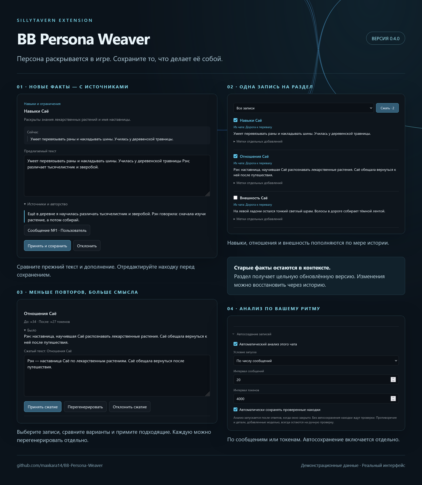

<div align="center">

# 🪶 BB Persona Weaver

**Персона раскрывается в игре. Weaver помогает сохранить найденные детали.**

SillyTavern · v0.4.0

**Русский** · [English](README.en.md) · [Быстрый старт](#-быстрый-старт) · [Автоматизация](#-автосоздание-записей)

</div>

---

Расширение для **SillyTavern**, которое находит в РП новые сведения о вашей персоне и предлагает сохранить их в её лорбук: привычки, навыки, внешность, прошлое, ценности и отношения.

Начните с короткого описания персоны, играйте и постепенно дополняйте её образ. **Weaver показывает источники и предлагает правки существующих разделов**, чтобы книга развивалась вместе с историей.

> **Открывается из «волшебной палочки» → Persona Weaver.**
> В списке установленных расширений — **BB Persona Weaver**. Все настройки находятся внутри окна, под **⚙**.



## ✨ Возможности

| | Что умеет Weaver |
|---|---|
| 🔎 **Анализ сцены** | Читает выбранный диапазон сообщений и извлекает новые устойчивые детали |
| 🧵 **Развитие разделов** | Одна пополняемая запись на категорию; новые категории предлагаются на ручную проверку |
| 💬 **Источники** | Модель ссылается на абзацы, Weaver подставляет оригинальный текст и авторство |
| ✍️ **Проверка находок** | Позволяет изменить текст, ключи и параметры перед сохранением |
| 🌐 **Regex RU / EN** | Запрашивает пару русских и английских ключей с Unicode-границами |
| 📖 **Один лорбук** | Создаёт и привязывает книгу к персоне или использует уже выбранную |
| 🏷️ **Метки** | Различает «Общее» и «Из чата», сохраняя происхождение добавлений |
| ⚙️ **Три подключения** | Текущее подключение ST, профиль Connection Manager или отдельный API |
| ⏱️ **Автоматизация** | Запускает анализ по числу сообщений или токенов; автосохранение включается отдельно |
| ↩️ **История** | Хранит версии, поддерживает откат и восстановление незавершённых сохранений |
| 🎛️ **Отбор и приоритет** | События сюжета включаются отдельно; приоритет новых разделов — ручной, автоматический или обратный |

Компактное тёмное окно, акцент из темы ST, стабильные размеры при переключениях и адаптация к небольшим экранам.

## 📦 Установка

1. Откройте **Расширения → Установить расширение** в SillyTavern.
2. Вставьте адрес репозитория:

   ```text
   https://github.com/maxkara14/BB-Persona-Weaver
   ```

3. Подтвердите установку и обновите страницу.
4. Откройте **«волшебную палочку» → Persona Weaver**.

Если расширение уже установлено, обновляйте имеющуюся копию — вторую устанавливать не нужно.

## 🚀 Быстрый старт

1. Откройте сохранённый чат и выберите свою персону.
2. Нажмите **«волшебная палочка» → Persona Weaver**.
3. В **⚙** выберите подключение и модель. Нажмите **«Готово»**.
4. Задайте сообщения **«От» / «До»** и нажмите **«Анализировать»**. Нумерация начинается с нуля, обе границы входят в диапазон.
5. Откройте находку, сравните текст и проверьте цитаты. Исправьте всё, что не хотите закреплять в каноне.
6. Нажмите **«Принять и сохранить»**. Если книга ещё не привязана, Weaver создаст её при первом сохранении.

Без включённого автосохранения анализ сам по себе не меняет лорбук. Пустой результат тоже считается успешным анализом сцены.

### Подготовить книгу заранее

**⚙ → Лорбук персоны → Создать лорбук**: введите название и нажмите **«Создать и привязать»**. Книга появится пустой и сразу станет лорбуком текущей персоны.

Существующая книга с таким названием не перезаписывается. При смене контекста до привязки она не будет привязана к другой персоне. Ранее привязанная книга не удаляется.

## 🧠 Какие детали сохраняются

Начальные категории: **внешность**, **привычки и предпочтения**, **навыки и ограничения**, **прошлое и семья**, **ценности и границы**, **отношения**. Пустые разделы заранее не создаются.

Каждой категории соответствует одна запись лорбука: **«Внешность [имя]»**, **«Привычки [имя]»**, **«Навыки [имя]»**, **«Биография [имя]»**, **«Ценности [имя]»**, **«Отношения [имя]»**. Новые NPC добавляются именованными абзацами внутрь «Отношений», а новые приёмы — внутрь «Навыков». Модель получает полный прежний текст и предлагает обновлённый раздел для проверки. Прежние ключи активации и настройки записи сохраняются.

Модель также может предложить **новую категорию** с содержимым и обоснованием, если существующие разделы не подходят по смыслу. Такие предложения всегда ждут ручного принятия, даже при автосохранении. В «Находках» можно изменить название или выбрать другой раздел и нажать «Обновить предложение». Перенос формирует редактируемый черновик из прежнего текста выбранного раздела и нового дополнения; проверьте его связность перед сохранением. Принятую категорию можно дополнять в следующих сценах. Перед её созданием проверьте, нет ли уже подходящего раздела. Учитываются разделы этой персоны, которыми управляет Weaver; произвольные чужие записи автоматически не присваиваются.

Инструкции просят модель отличать устойчивый факт от разового действия, временной эмоции, чужого мнения или предположения. Один применённый приём не должен превращаться в профессиональную квалификацию. Это инструкции модели, поэтому источники и итоговый текст стоит проверять.

В **Параметрах записей → «Сохранять значимые события персоны»** можно разрешить краткие вехи личной истории. По умолчанию настройка выключена: сохраняются установленные факты и изменения персоны, а не хроника боёв, поездок и случайных встреч. Раскрытое прошлое, новые навыки, обязательства и последствия вроде постоянного шрама остаются допустимыми. Ранее принятая история не удаляется. Правило действует и с пользовательским промптом, при ручном и автоматическом анализе.

Там же задаётся **приоритет новых записей**: вручную (по умолчанию 100), автоматически по номеру раздела (1, 2, 3…) или в обратном порядке от заданного числа (по умолчанию 9999). Номер считается по разделам этой персоны в текущей книге на момент сохранения. Значения ограничены 0–9999. Дополнение существующего раздела сохраняет его приоритет.

При дополнении передаётся полный прежний текст категории. Модель должна подготовить цельную отредактированную версию раздела: встроить дополнения в нужные абзацы, объединить повторы и сохранить прежние факты. Качество такого редактирования зависит от модели; перед сохранением доступны старый и предлагаемый тексты.

Weaver изменяет только собственные записи данной персоны. Основное описание персоны и чужие записи не переписываются.

В «Находках» и «Сценах» результаты показываются по 20 на страницу, с переходами «Новее» / «Раньше» и фильтрами «Все», «С находками», «Ожидают решения». Фильтр «С находками» также оставляет результаты с ошибками источников, чтобы они не потерялись. Ограничение не удаляет журнал и не меняет покрытие сцен. В истории выполненный откат явно обозначается как «Запись удалена» либо «Предыдущая версия восстановлена».

У каждой находки можно посмотреть оригинальные фрагменты РП и номера сообщений, на которые она опирается. Если источник не удалось подтвердить, предложение показывается отдельно с причиной; остальные корректные находки остаются доступны.

Результат с ошибками источников не отмечает сцену обработанной. При автосохранении сохраняются только прошедшие проверку находки с разрешёнными источниками; автоматические повторы приостанавливаются до проверки и сброса ошибки автоматизации. Если ответ модели не удалось обработать, Weaver сообщит об ошибке и предложит повторить анализ.

### Один лорбук, разные метки

**«Общее»** и **«Из чата: название»** помогают ориентироваться в книге. Раздел может пополняться из нескольких чатов — прежние источники сохраняются.

Метки **не ограничивают активацию**. Книга работает штатно везде, где подключена; фильтр во вкладке «Записи» влияет только на отображаемый список.

## 🗜️ Сжатие записей

Во вкладке **«Записи»** отметьте нужные разделы галочками рядом с названиями и нажмите **«Сжать»** у фильтра списка. Кнопка показывает число выбранных записей. Можно отправить до 20 записей одним запросом через выбранное подключение. Если они не помещаются в бюджет, выберите меньше записей или увеличьте бюджет в настройках.

Каждая запись получает отдельный редактируемый вариант с прежним текстом и примерным размером в токенах. Можно принять сжатие, отклонить его или перегенерировать только эту запись. Результаты остаются в очереди после закрытия окна и перезагрузки страницы. Ключи, приоритет, настройки активации и источники записи сохраняются.

Отдельный промпт находится в **⚙ → «Промпт сжатия записей»**. По умолчанию он просит убрать повторы и сократить формулировки без потери фактов; перед принятием проверьте, что модель сохранила важные детали. Сжатие не анализирует РП заново и не требует ссылок на сообщения.

Принятое сжатие появляется в общей **«Истории»**. Кнопка **«Восстановить предыдущую версию»** возвращает запись до сжатия. Если после подготовки предложения или после его применения запись менялась, сохранение или откат блокируются, чтобы защитить более свежие правки.

## 🌐 Язык и ключи активации

Исходный промпт написан **на английском**, а содержимое записи должно следовать **основному языку описания персоны**. Названия разделов фиксированы и содержат имя персоны. Для смешанного описания учитывается основной язык повествования; далее — язык существующей записи и сообщений пользователя. Обоснования в окне проверки остаются на русском.

Для каждой находки подбираются **два ключа активации — русский и английский**, независимо от языка записи. Каждый ключ редактируется целиком на своей строке. Если ключ не удалось проверить, Weaver сообщит об ошибке до сохранения.

В **⚙ → Промпт сборки и ключей** можно редактировать инструкции. Правила работы с разделами и источниками применяются и к пользовательским инструкциям. **«Восстановить промпт»** возвращает текущий исходный текст; ранее сохранённые пользовательские инструкции автоматически не заменяются.

## 🔌 Подключения

| Источник | Настройка |
|---|---|
| **Текущее подключение** | Использует действующее подключение SillyTavern; дождитесь окончания основного ответа |
| **Профиль подключения** | Выберите профиль Connection Manager; для текстовых профилей используется штатное преобразование промпта |
| **Отдельный API** | Укажите базовый OpenAI-совместимый URL, ключ и модель; можно загрузить список моделей или ввести ID вручную |

Для отдельного API используйте адрес вида `https://example.com/v1`. Провайдер должен разрешать запросы из браузера.

**URL, модель и ключ отдельного API сохраняются в настройках SillyTavern.** Ключ остаётся после перезагрузки страницы и хранится в настройках в открытом виде, как в Enhance. Чтобы удалить его, очистите поле API-ключа. В промпт и экспорт журнала ключ не передаётся. Ошибка не переключает источник автоматически.

Тайм-аут, лимит ответа и общий бюджет контекста находятся в **«Дополнительно»**. Оценка токенов использует токенизатор текущего ST и может отличаться от выбранной модели.

## ⏱️ Автосоздание записей

Откройте **⚙ → Автосоздание записей**:

1. Включите **«Автоматический анализ этого чата»**.
2. Выберите запуск **по сообщениям** или **по токенам**, задайте порог.
3. При желании включите **«Автоматически сохранять проверенные находки»**.

Автоматизация срабатывает **после ответов, при закрытом окне Weaver**. Без автосохранения находки попадают в очередь. При автосохранении противоречия и детали, основанные на сообщениях модели, всё равно остаются на ручную проверку.

Успешно обработанные сообщения не отправляются повторно без явного запуска. Ошибка останавливает автоматические повторы; после исправления подключения используйте **«Сбросить ошибку автоматизации»**. Обработка продолжится после следующего ответа.

### Уведомления

Автоматизация показывает всплывающие уведомления Persona Weaver о запуске анализа и его результате: сколько записей подтверждённо сохранено и сколько находок ждёт проверки. Успешный анализ без новых деталей тоже сопровождается уведомлением.

Во время ручного и автоматического анализа в окне видны спиннер, диапазон сообщений и текущий этап. Окно можно закрыть и открыть снова: запрос продолжится. Кнопка **«Остановить»** отдельно отменяет запрос; смена чата или персоны по-прежнему отменяет анализ для прежнего контекста.

При частичном сбое отдельно указывается число неподтверждённых операций и предлагается проверить «Историю». Ошибка остаётся на экране до закрытия. Ожидание порога и уже обработанные сцены не создают уведомлений. Тексты РП в уведомления не выводятся.

## 🎛️ Параметры записей

В **⚙ → Параметры записей** задаются настройки новых разделов:

| Настройка | По умолчанию | Действие |
|---|---|---|
| **Сохранять значимые события персоны** | Выключено | Разрешает личные вехи дополнительно к фактам и изменениям персоны |
| **Приоритет новых записей** | Вручную, 100 | Фиксированное число, номер раздела или обратный отсчёт; диапазон 0–9999 |

Обновление существующего раздела сохраняет его приоритет. Новые кастомные категории всегда требуют ручного принятия, независимо от автосохранения.

В настройках и карточке находки доступны:

- **Постоянная активация**;
- **Векторизация** — штатный флаг ST;
- исключение из **рекурсивного сканирования**;
- запрет запуска **рекурсии из записи**.

Обычная активация: постоянная и векторизация выключены. Настройки по умолчанию применяются к новым записям; у существующих сохраняются собственные параметры. Старые ключи сохраняются, новые добавляются без точных дублей; итоговый набор можно отредактировать.

## 🗂️ Сцены, история и восстановление

| Вкладка | Для чего |
|---|---|
| **Находки** | Просмотр результатов, редактирование и принятие предложений |
| **Записи** | Управляемые записи и метки отдельных добавлений |
| **Сцены** | Журнал успешных анализов, включая результаты без находок |
| **История** | Версии до/после, откат, проверка незавершённых записей и экспорт |

Изменение сообщения или свайпа делает соответствующий анализ устаревшим. Учитываются пересекающиеся диапазоны и необработанные участки. Новый чат или ветка ведут собственный журнал.

Перед сохранением Weaver перечитывает книгу и проверяет исходную версию записи. Поздние ручные правки блокируют замену и откат. Если ответ сохранения потерян, **«Проверить / повторить незавершённую запись»** сверит результат с книгой и не создаст уже записанное повторно.

Для обновлений кнопка **«Восстановить предыдущую версию»** возвращает состояние записи до выбранной операции: текст, название, ключи и настройки. Для создания кнопка **«Удалить созданную запись»** удаляет созданную той операцией запись только после подтверждения. Если после операции запись менялась, откат блокируется. Выполненный откат остаётся отдельной строкой истории; исходная операция отмечается отменённой.

## 💾 Хранение данных

Лорбук сохраняется в SillyTavern. Очередь находок, результаты и история хранятся в текущем браузере, отдельно для персоны и чата. Между браузерами они не синхронизируются. Очистка данных сайта удаляет локальную историю, но не серверный лорбук.

Историю можно экспортировать из расширения. Экспорт содержит тексты РП. При достижении лимита журнала Weaver сообщит об этом, не удаляя старые результаты автоматически.

Редактируйте книгу в одной вкладке: одновременные изменения из нескольких окон могут конфликтовать. Источники помогают проверить находки, но итоговый текст модели всё равно стоит прочитать перед сохранением.

---

[Документация для разработчиков](docs/testing.md) · [Интеграция с SillyTavern](docs/integration-notes.md)
